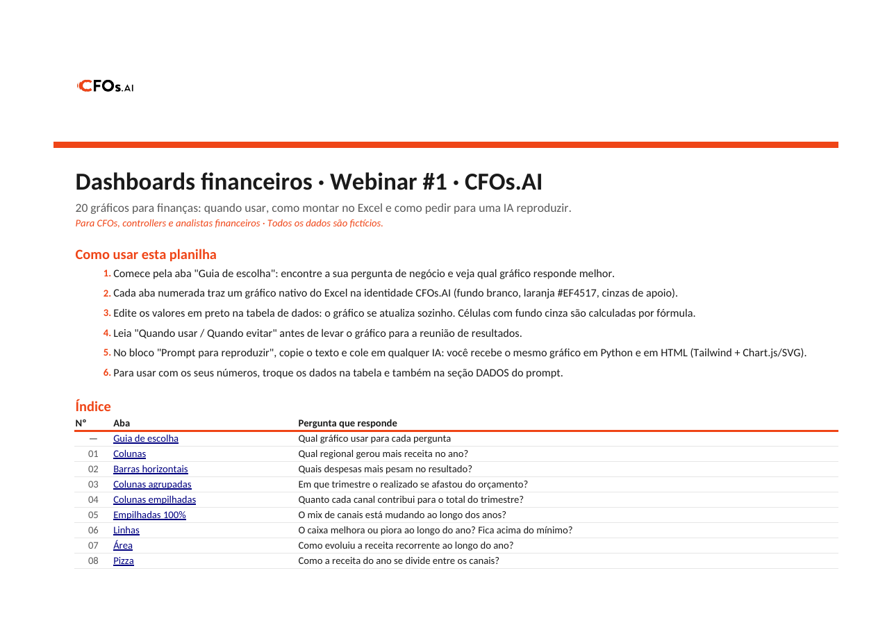
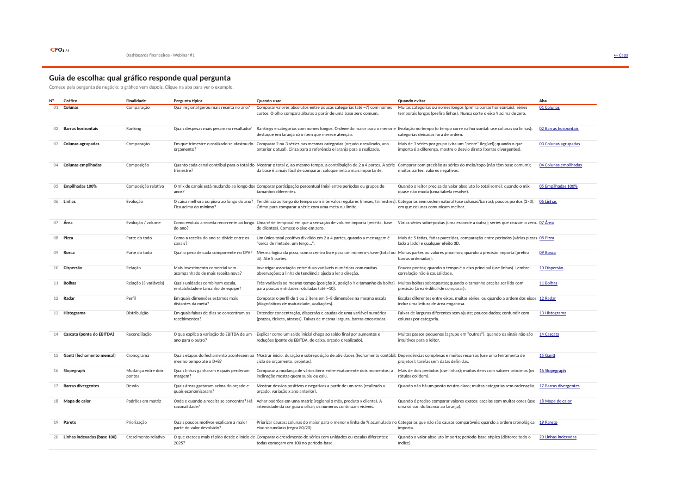
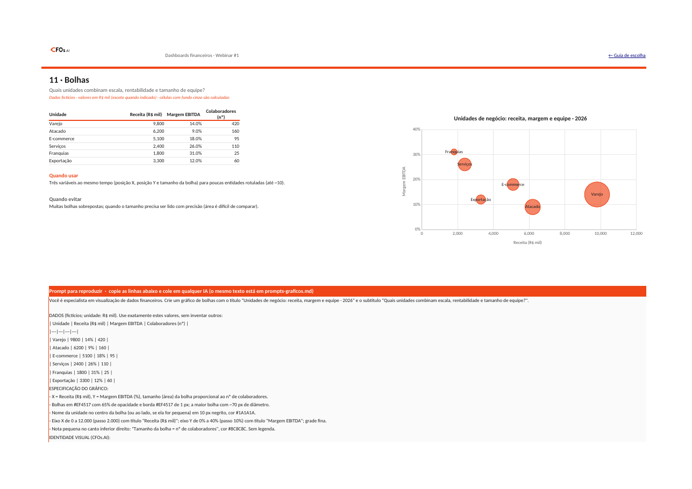
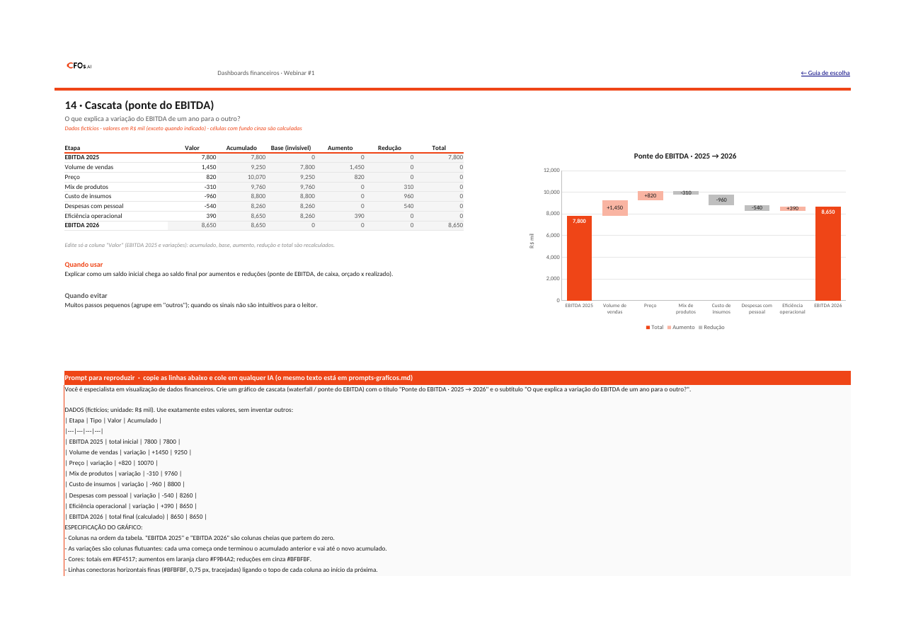
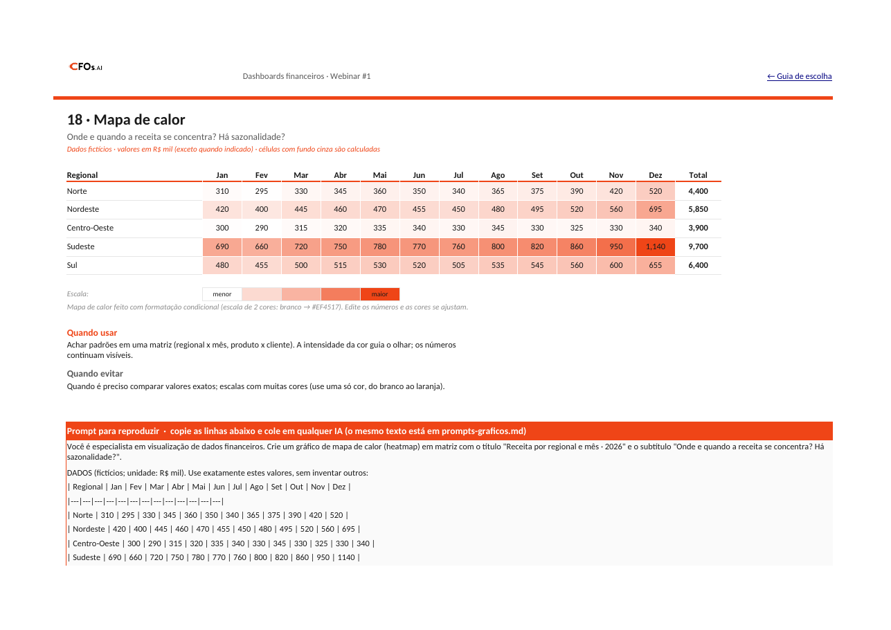
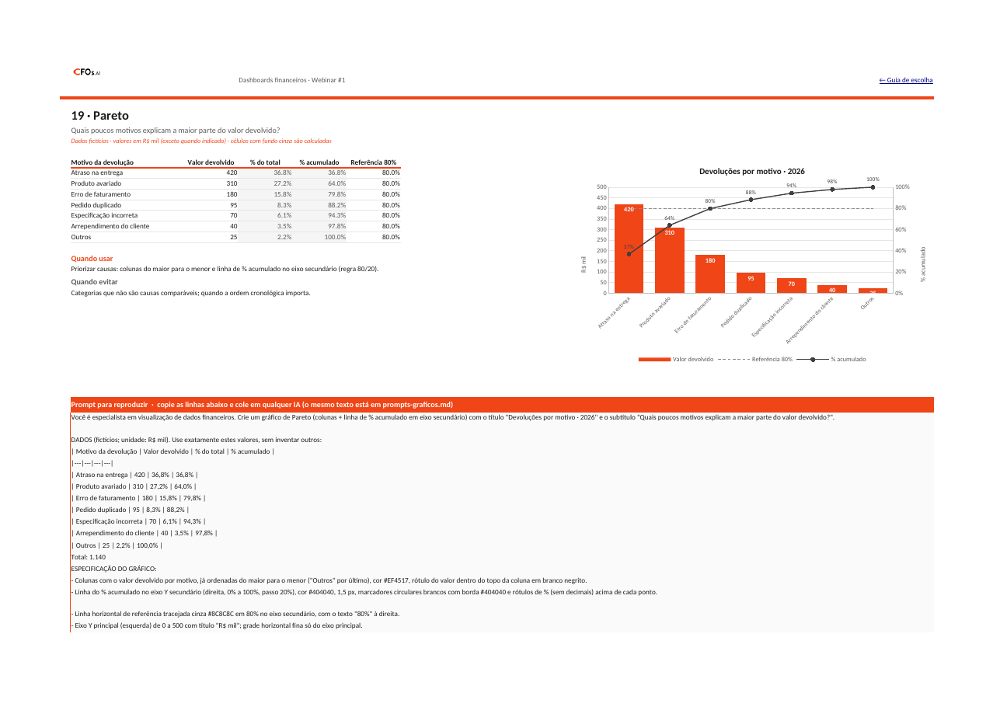

# Webinar #1 · Dashboards financeiros: criar e usar com GitHub

**Tema:** como escolher, montar e compartilhar dashboards financeiros, e como usar o GitHub para versionar o material.

**Data:** a definir.

## Agenda (rascunho)

1. Por que dashboards no financeiro
2. Guia de escolha: qual gráfico responde qual pergunta (colunas, barras, linhas, pizza/rosca, dispersão, cascata, Gantt, Pareto, mapa de calor...)
3. Mão na massa: montando os gráficos na identidade CFOs.AI
4. GitHub para quem é de finanças: repositório, commits e compartilhamento
5. Perguntas e respostas

## Materiais

- [Planilha de gráficos com dados fictícios](./dashboards-financeiros-cfosai.xlsx) (identidade CFOs.AI)
- [Prompts para reproduzir os gráficos](./prompts-graficos.md) (copie e cole em qualquer IA)
- [Apresentação do webinar](./apresentacao/Webinar-01-Dashboards-financeiros-com-GitHub-e-IA.pptx) (slides em PowerPoint)
- Gravação: disponibilizada após o webinar

## Prévias dos gráficos

Abaixo, algumas prévias dos gráficos incluídos na planilha.

### Capa da planilha

### Guia de escolha

### Gráfico de bolhas

### Gráfico cascata (ponte do EBITDA)

### Mapa de calor

### Gráfico de Pareto

---

> Todos os dados são fictícios. Nenhuma credencial ou dado real é versionado aqui.
